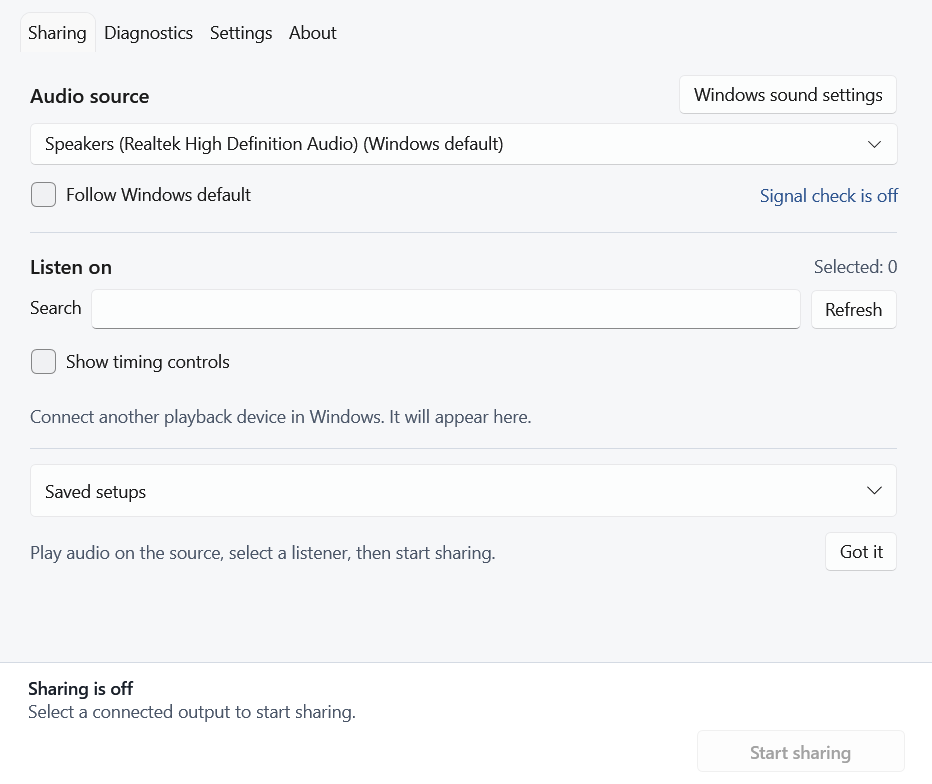

# WaveTandem

**Share the sound from one Windows playback device with other headphones or speakers.**

Use your laptop speakers and a headset together, or listen on a mix of USB, wired, and Bluetooth devices that Windows can play to at the same time. WaveTandem runs locally and uses the playback devices you already have.



[Dark theme](docs/images/sharing-dark-uk.png) · [Releases](https://github.com/SerDrozd/WaveTandem/releases) · [Troubleshooting](docs/troubleshooting.md) · [Build from source](#build-and-test)

## Start listening

1. Connect two playback devices in **Windows → Settings → System → Sound**. Play something on one of them.
2. Extract the entire x64 ZIP and open `WaveTandem.exe`. The portable ZIP includes the .NET desktop runtime.
3. Under **Audio source**, select the device already playing. Enable **Follow Windows default** if you want WaveTandem to follow the Windows playback selection.
4. Under **Listen on**, check the other devices and press **Start sharing**. You can also press **Ctrl+Enter** while the window has focus.
5. Check the source signal and try **Test sound** on an enabled listener if you hear nothing there.

**Source** is where Windows already plays the sound. **Listener** is an additional device that receives a copy.

## Everyday controls

| What you want to do | Where to do it |
| --- | --- |
| Find why you hear nothing | Read the source signal status. If the source has signal, use **Test sound** on the connected, unmuted listener to check its playback path. |
| Pause everyone else while your own sound continues | Use **Pause copies** in the window or tray menu. Resume keeps the listener volume, mute and delay settings. |
| Swap your main headset as Windows switches devices | Enable **Follow Windows default** before starting. WaveTandem rebuilds the route when Windows changes its default and excludes the new source from the listeners. |
| Set different levels for two people | Use the volume and mute controls on each checked listener. These change the copies sent by WaveTandem. |
| Reduce an audible echo between listeners | Open the timing controls. Play a series of clicks and add delay to an additional output that you hear early. |
| Reuse a setup for a film, desk or set of headphones | In **Saved setups**, save the source choice, listeners, volume, mute and delay while sharing is off. Load the setup, confirm the connected devices, then start sharing. |
| Share enough information to get help | In **Diagnostics**, use **Copy support report** for stream states, queue metrics and error codes with device names and IDs omitted. |

Selected devices reopen after reconnecting with the same Windows endpoint ID. If Windows assigns a replacement ID, select that endpoint. Choose **Light** or **Dark** in Settings. The interface is available in English, Russian and Ukrainian.

## Compatibility and timing

- The target is **Windows 11 x64**. The same WASAPI APIs are available on Windows 10 22H2. See the [device matrix](docs/device-compatibility.md) for the verification status.
- Windows must expose separate playback devices and be able to play to them simultaneously. If your PC already offers **Shared Audio** and two compatible Bluetooth LE Audio accessories, you can use Quick Settings to share directly. [Microsoft Shared Audio](https://techcommunity.microsoft.com/blog/windowsosplatform/share-the-moment-listen-together-with-shared-audio/4522401).
- WaveTandem reads the shared mix on a selected output. Protected audio and playback that bypasses the shared mix may be absent. [WASAPI loopback](https://learn.microsoft.com/en-us/windows/win32/coreaudio/loopback-recording).
- Drift correction keeps per-output queues stable. The reported delay estimates **software buffering**. Bluetooth transport and acoustic delay vary by device. The source’s direct Windows playback cannot be delayed by WaveTandem. [Timing and calibration](docs/latency.md).

## Build and test

Use PowerShell 7, .NET 10 SDK, CMake 3.24 or later, the Visual Studio 2022 C++ Build Tools, and a Windows SDK. With Visual Studio 2026 and a CMake version that supports it, pass `-Generator 'Visual Studio 18 2026'`.

```powershell
./scripts/check.ps1
./scripts/build.ps1 -Package
```

The script builds the C++20 engine and WPF application, runs CTest and xUnit, and creates `out/dist/WaveTandem-win-x64.zip` with a SHA-256 sidecar. Archives are unsigned. Run `Get-FileHash .\WaveTandem-win-x64.zip -Algorithm SHA256` to compare the ZIP with its sidecar. See the [verification guide](docs/testing.md) for the UI smoke harness, routing, and hardware tests.

## How it works

A WASAPI loopback worker reads the source. Each listener has a bounded queue, its own resampler and its own WASAPI render stream. A feedback controller adjusts each resampling ratio independently. The WPF app talks to the native engine through a versioned C ABI. [Architecture](docs/architecture.md) · [Audio pipeline](docs/audio-pipeline.md) · [Synchronization](docs/synchronization.md).

Audio stays in memory on the PC. Settings are saved under `%LOCALAPPDATA%\WaveTandem`. The application requires no account and sends no audio or telemetry over the network.

[Contributing](CONTRIBUTING.md) · [Security](SECURITY.md) · [Roadmap](docs/roadmap.md) · [MIT license](LICENSE)

Development began on 12 November 2026 under the name SyncEar. The Git history begins on 26 November 2026.
