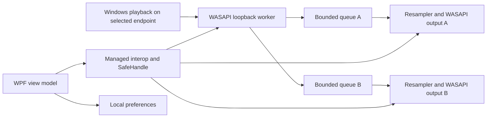

# Architecture

- **Native** owns COM, capture and render threads, DSP, queue counters, endpoint IDs and lifecycle states. Each audio worker initializes COM and enrolls in MMCSS where available. An event wakes workers for audio. Timeout checks detect stale streams and allow idle loopback.
- **Interop** verifies ABI version 2 before starting a session. A `SafeHandle` owns the opaque session and joins all workers on release. HRESULT values transfer errors across the boundary. The enumeration callback copies Unicode strings before returning.
- **Core** defines endpoint and status records and pure settings normalization. Settings use versioned JSON with a bounded read. Save flushes a uniquely named temporary file in the same directory and replaces the old file. Invalid or future-schema files are preserved.
- **App** owns the observable device list, language, themes, onboarding and tray. Native operations are serialized off the dispatcher. A two-second enumeration poll updates active and default endpoints. Audio recovery is independent of the UI poll.

A session is pinned to an explicit source ID. Its output slots are append-only until stop. Once a slot is published, the capture thread can access it until the session joins. Disabling a listener retains the slot for reuse. The source receives a stop signal and joins before queues are destroyed. Capture never overwrites unread frames. Render owns the read cursor and can discard stale material after an overrun or discontinuity.

With a fixed source, the app reports a mismatch with the Windows default and retries the original endpoint after invalidation. With **Follow Windows default**, the app stops the old session and starts a new one after detecting a default change. It excludes the new source from its output routes, retains the listener selection and pause state, and waits if Windows reports no default. A replacement listener ID requires explicit selection.
